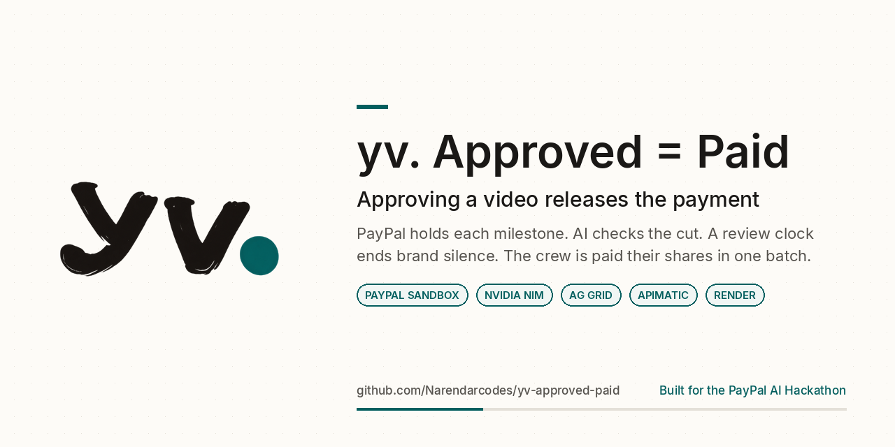

# yv. Approved = Paid

**AI checks facts, people own taste, the deal decides the money.**

yv. Approved = Paid turns a content deal into money that moves by itself, and only when the deal says so. It is built for **brands and their content operations teams**, and for the **editors and designers they pay**. Both sides sign the terms (hash-locked). Each milestone is funded with a **PayPal hold** (an authorization, not a charge). Machine checks run on every cut, and the hold is captured when the client approves the video. A dispute settles by the deal's own arithmetic: part of the hold is captured and the rest is voided.

**Live demo:** https://yv-approved-paid.vercel.app  ·  **Demo video (2:36):** https://youtu.be/D30ULf-qEFU  ·  **PayPal flow in detail:** [docs/paypal-sandbox.md](docs/paypal-sandbox.md)



---

## What's real vs simulated

Everything below runs in the **PayPal sandbox** (`api-m.sandbox.paypal.com`). No live money moves anywhere.

| Piece | Status | Detail |
|---|---|---|
| Orders v2 hold (`intent: AUTHORIZE`) | **Real** | A real sandbox order, approved by a real sandbox buyer account |
| Authorization | **Real** | `/v2/checkout/orders/{id}/authorize`. The id is stored on the milestone |
| Full capture when the client approves | **Real** | `/v2/payments/authorizations/{id}/capture` for exactly the signed amount |
| Partial capture + void (split, kill fee, reject) | **Real** | The share owed is captured, then `/void` releases the rest |
| Reauthorize after the 3-day honor period | **Real** | The Money Agent reauthorizes once per hold (PayPal allows one) |
| Change-order invoices (Invoicing v2) | **Real** | `INV2-...` invoices are created **and sent** |
| Judge demo without a PayPal login | **Real ids** | Holds come from a pool of authorizations a sandbox buyer approved ahead of time (see below) |
| Demo when the pool is empty | Simulated, labelled | Falls back to `SIM-AUTH-` / `SIM-CAPTURE-` ids on an in-memory twin with PayPal's rules. Each ledger line says "buyer approval simulated (pre-approved pool empty)" |
| Payouts to the editor and designer | Simulated, labelled | Tried for real every time. PayPal refuses Payouts for this India sandbox merchant (`PAYOUT_NOT_AVAILABLE`), so the ledger records `SIM-PAYOUT-...` with that error |
| Deal copilot | **Real** (with a labelled fallback) | Live LLM: River AI (`Qwen/Qwen3.8-27B-FP8`), then NVIDIA NIM. Falls back to an **offline replay** with no model call when the agent is slow or down |

**Verified live on Nov 4, 2026** (each id checked directly on `api-m.sandbox.paypal.com`):

| Milestone | Authorization | Result |
|---|---|---|
| Reel 1, approved | `75944066TD8606012` | Capture `6CX25059D6955990M`, **$400.00 COMPLETED** |
| Reel 2, dispute split | `7LJ85033A19963041` | Partial capture `8L3248257U421871X` (**$240**), then the authorization **VOIDED** (the remaining $60 released) |

In the web app every PayPal id carries a tag: `PayPal sandbox` (real) or `PayPal sandbox · simulated`. The money timeline has a **PayPal ids** panel with each milestone's authorization and capture ids.

---

## Judge quick start

1. Open **https://yv-approved-paid.vercel.app** and press **Try the demo** on the login page. You don't need a PayPal account or a password.
2. The first load can take **about a minute**: the API and the agent run on Render's free tier and sleep when idle.
3. You land on the **"Diwali launch reels"** deal:
   - **Reel 1** has already been approved. Its hold was captured for the signed $400, and the authorization and capture ids are in the **PayPal ids** panel on the money timeline.
   - **Reel 2** is in dispute. 4 of 5 checklist lines passed, so the proposed split is 80% ($240). Accept the split and the Money Agent captures $240 and voids the rest (it runs every 60 s).
   - Ask the copilot to "capture $450" or "pay the old version". The request is dry-run and comes back **blocked** (`P3_amount` / `P6_version`) with "No money moved".
4. To start over on a fresh pair of real holds, the judge account can reset the demo (`POST /api/v1/demo/deal/reset`, at most once every 2 minutes for everyone).

The copilot badge reads **ready** until it answers, then **live AI · provider** for a model reply, or **offline replay** only after a replayed one.

---

## Architecture and money flow

```
 apps/web (React + Vite, Vercel)
     │  REST + Socket.IO (deal:join -> deal:ledger)
     ▼
 apps/api (Node + Express, Render) ── the only writer ──► MongoDB Atlas
     │   policy engine: every money move is dry-run first; AI never sets an amount or a verdict
     │   Money Agent: acts on the signed terms, appends to a hash-chained ledger
     ├──► PayPal sandbox: Orders v2, Payments v2 (authorize / capture / void / reauthorize), Invoicing v2, Payouts
     └──► services/agent deal copilot (FastAPI, Render) ──► River AI ─(fallback)─► NVIDIA NIM
```

**Money flow, per milestone:**

```
 sign terms (hash-locked)
   └─► fund: Orders v2 AUTHORIZE ─► buyer approves ─► authorize   = HOLD (no charge yet)
         │                          (demo: drawn from the pre-approved pool)
         ├─ client approves the version ─────────► capture the signed amount       = PAID
         ├─ dispute split / kill fee ────────────► partial capture of the agreed share
         │                                         + void the rest               = SPLIT
         ├─ reject, nothing owed ────────────────► void                          = RELEASED
         └─ still open after the 3-day honor period ─► reauthorize once            = HOLD KEPT
 change order (priced from the signed rate card) ─► Invoicing v2 invoice, sent
 captured money ─► payouts to the payees by the signed split (simulated: PAYOUT_NOT_AVAILABLE)
```

A split is computed in Node from the checklist (lines passed / lines signed × milestone amount, capped at what is held). It counts as agreed only when both sides accept the same number. No route takes an amount from an agent or a model.

---

## Built With

- **PayPal** (sandbox): Orders v2 (`intent: AUTHORIZE`), Payments v2 (authorize, capture, void, reauthorize), Invoicing v2, Payouts (simulated, see above)
- **River AI**: `Qwen/Qwen3.8-27B-FP8`, the copilot's primary model
- **NVIDIA NIM**: `nvidia/nemotron-3.5-lightning-30b-a3b`, the copilot's fallback model
- **Render**: the API and the lean deal agent (free tier)
- **Vercel**: the web app
- **MongoDB Atlas**: the system of record (deals, hash-chained ledger, authorization pool)
- **React + Vite** (TypeScript, Tailwind CSS, TanStack Query, Socket.IO client)
- **Node.js 24** + Express, Mongoose, Socket.IO; **Python** FastAPI for the agent

---

## Run locally

Needs Node.js 24+, npm and a MongoDB 7 (for example `docker run -d -p 27017:27017 mongo:7`, or an Atlas URI in `MONGO_URI`).

```bash
# 1. API with the judge demo on the mock PayPal (no PayPal account needed)
cd apps/api && npm ci && cp .env.example .env
DEMO_MODE=1 PAYPAL_MODE=mock npm run dev        # http://localhost:3000, seeds "Diwali launch reels" on boot

# 2. Web app, in another terminal
cd apps/web && npm ci && npm run dev            # http://localhost:5173 -> /login -> "Try the demo"
```

On the real PayPal sandbox instead (your own sandbox app's REST credentials, never committed):

```bash
cd apps/api
DEMO_MODE=1 PAYPAL_MODE=sandbox PAYPAL_CLIENT_ID=... PAYPAL_CLIENT_SECRET=... npm run dev
# real holds from the pre-approved pool, real capture / void, INV2 invoices; SIM- ids only if the pool is empty
```

Your sandbox starts with an empty pool. Fill it with `apps/api/scripts/paypal-auth-pool.cjs` ([docs/paypal-sandbox.md](docs/paypal-sandbox.md#refilling-the-pool)).

Live copilot (needs a River or NIM key in the agent's env; without it the copilot runs as an offline replay):

```bash
cd services/agent && pip install -r requirements-deals.txt
AGENT_SHARED_SECRET=<32+ chars> RIVER_API_KEY=... NVIDIA_API_KEY=... uvicorn app.deals_service:app --port 8100
cd apps/api && AGENT_ENABLED=true AGENT_URL=http://127.0.0.1:8100 AGENT_SHARED_SECRET=<same> DEMO_MODE=1 PAYPAL_MODE=mock npm run dev
```

Tests: `cd apps/api && npm test` (Jest + mongodb-memory-server; no test calls real PayPal) and `cd services/agent && python -m pytest -q`.

---

> **Monorepo:** `apps/api` (Node API), `apps/web` (React + Vite), `services/agent` (Python agents and the lean deal copilot),
> `contracts` (shared schemas + codegen), `infra` (docker compose, e2e). See [ARCHITECTURE.md](ARCHITECTURE.md).
> Approved = Paid is built on **yv.**, a content operations platform (idea -> brief -> tasks -> review -> approval -> publish -> invoice) described further down.

## Table of contents

- [What's real vs simulated](#whats-real-vs-simulated)
- [Judge quick start](#judge-quick-start)
- [Architecture and money flow](#architecture-and-money-flow)
- [Built With](#built-with)
- [Run locally](#run-locally)
- [Built during the PayPal AI Hackathon](#built-during-the-paypal-ai-hackathon)
- [Deals (Approved = Paid)](#deals-approved--paid)
- [What yv. content ops is](#what-yv-content-ops-is)
- [Features](#features)
- [Tech stack](#tech-stack)
- [Project layout](#project-layout)
- [Quickstart](#quickstart)
- [Docker](#docker)
- [Configuration](#configuration)
- [API](#api)
- [Project lifecycle](#project-lifecycle)
- [Roles & permissions](#roles--permissions)
- [Tests](#tests)
- [Feature coverage vs Fluit](#feature-coverage-vs-fluit)
- [Status & roadmap](#status--roadmap)

---

## Built during the PayPal AI Hackathon

**Demo video (2:36):** https://youtu.be/D30ULf-qEFU  ·  **Live demo:** https://yv-approved-paid.vercel.app

yv. is my own project. I started its content-ops core (projects, tasks, briefs, reviews, chat, contracts and invoice pages) in August 2026, before the hackathon opened on Oct 1, 2026. Everything below was built during the Submission Period (Oct 1 to Nov 12, 2026):

**October 2026**
- Python agent platform (`services/agent`, FastAPI + LiteLLM) behind the Node API, with a shared JSON Schema contract and scoped service tokens
- Review digest agent: merges many reviewers' notes into one change list
- Brand Brain: brand knowledge and analytics insights agent
- Pipeline-first redesign, analytics ingestion and a visual polish pass

**November 2026: Approved = Paid (this repo)**
- Deals engine: milestones, signed terms, payee splits and an append-only money ledger
- PayPal: Orders v2 AUTHORIZE holds milestone funds, approving a video captures the hold (Payments v2 capture), a rejected or disputed milestone voids the rest, and Invoicing v2 sends change-order invoices on the sandbox. The judge demo draws its holds from a small pool of authorizations a sandbox buyer approved ahead of time, so judges need no PayPal login (filled and verified live on Nov 4, 2026 with a US sandbox buyer: real authorization, real capture on approve, real partial capture + void on a split; each demo reset uses one pair, and an empty pool falls back to a labelled simulation). Payouts are simulated and labelled, because sandbox payouts aren't available for India accounts.
- Policy engine: every money move gets a dry run first, and AI never sets amounts or verdicts
- AI agents for video QA checks, review, money and disputes, plus a live deal copilot (River AI, NVIDIA NIM fallback)
- Team assignment: Assign picker, real invites and a deal Team card that locks the split at signing
- Change orders, disputes paid by the deal's own rule, one-click judge demo, Render + Vercel deploys and a policy red-team test suite

## Deals (Approved = Paid)

**AI checks facts, people own taste, the deal decides the money.**

Built for the PayPal AI Hackathon, for brands and their content operations teams and the editors and designers they pay. A deal is signed terms (hash-locked), a PayPal hold per milestone (an authorization, not a charge), machine checks on every cut, and money that moves only when the deal says so.

- **Pages:** `/deals` (your deals) and `/deals/:dealId` (one deal as cards). On `/login`, **Try the demo** calls `POST /api/v1/auth/demo-login` (only when the API runs with `DEMO_MODE=1`; the button hides itself on a 404) and opens the seeded "Diwali launch reels" deal.
- **Cards** (`apps/web/src/components/deals/`): DealCard (terms hash, both signatures, per-milestone amount, due + grace, review window, rounds left, kill fee), LiveChecksCard (measured vs target per checklist line, screenshot evidence from `GET .../deals/:dealId/evidence/:file`; taste lines say "people decide"), ReviewMergeCard (Fix cites a failed line, Taste costs a round, never pay), MoneyTimeline (hash-chained ledger, live over Socket.IO `deal:join` -> `deal:ledger`; blocked attempts show the rule and "No money moved"), ChangeOrderCard (priced from the signed rate card; Accept drafts the PayPal invoice), DisputeSplitCard (split from checklist arithmetic; agreed only when both sides accept the same number), PolicyBlockedChip.
- **Deal copilot:** a side panel that answers by rendering those cards. With the live agent on, an LLM picks which cards answer the question (`POST .../deals/:dealId/copilot` -> the lean deal agent); otherwise, or when the agent is slow or down, it runs as an offline replay (deterministic intent matching, no model call), so the demo always works. Every reply is labelled **live AI · <provider>** or **offline replay**. It only proposes: a "capture $450" or "pay the old version" ask is dry-run through `POST .../policy-check` and comes back as a PolicyBlockedChip. No copilot action takes an amount it wrote: the model only names cards and ids from the deal (checked by the agent, the API and the web), and a capture uses the signed amount or the number the person typed.
- **Live AI agent (optional):** `services/agent/app/deals_service.py`, a lean FastAPI service (`Dockerfile.deals`, `requirements-deals.txt`: fastapi, uvicorn, httpx, pydantic; ~40 MB RSS) that fits a Render **free** web service (`render.yaml`, `GET /health`). LLM routing (`app/deals/llm_router.py`): River AI (`Qwen/Qwen3.8-27B-FP8`) -> NVIDIA NIM (`nvidia/nemotron-3.5-lightning-30b-a3b`) -> OmniRoute (only if `OMNIROUTE_URL` is set). Names are stripped before any prompt leaves; the model never sees amounts. The API calls it only when `AGENT_ENABLED=true`, `AGENT_URL` and `AGENT_SHARED_SECRET` (sent as `X-Agent-Secret`, same value on both services) are set; it gives up after `AGENT_COPILOT_TIMEOUT_MS` (15 s; a free instance cold-starts slowly) and answers `{ source: 'offline' }`.
- **Agents** (`services/agent/app/deals/`): the Review Agent's Fix/Taste merge and the Scope & Dispute proposal are stored on the milestone through `POST /internal/deals/:id/milestones/:key/review` and `.../dispute-proposal`. The dispute call sends no amount; Node computes the split.
- **Team and assignment:** projects and tasks get an **Assign** picker (org members with avatar and role; admins and editors only, everyone else sees the assignee read-only) on `/projects/:id`. The API only assigns to active members of the same org (`422 assignee_not_member`). The **Deal team** card on `/deals/:dealId` shows each milestone's payees and split (e.g. Ravi 70% / motion designer 30%). Before both sides sign, the client picks members and types the shares: `POST .../deals/:dealId/milestones/:key/team/check` dry-runs the rules (T1 client only, T2 unsigned only, T3 shape, T4 shares = 100%, T5 org members only) and `PUT .../milestones/:key/team` saves and clears signatures. After signing it is read-only (`409 deal_locked`): payees move money, and PayPal pays only the people named in the signed deal. Per-payee amounts are computed from the milestone amount; no AI or request sets a payee, share or amount.
- **Shared types:** `contracts/schemas/deal.schema.json` (DealView, ledger view, `deal:ledger` payload), generated into the API, web and agent by `contracts/gen.sh`.

- **PayPal modes** (`PAYPAL_MODE`, `apps/api/src/modules/deals/paypal.cts`):
  - `mock`: in-memory PayPal with the real rules (tests, offline demo). Ids end in `MOCK`; the UI tags them `mock`.
  - `sandbox`: the real PayPal sandbox (`api-m.sandbox.paypal.com`, needs `PAYPAL_CLIENT_ID` / `PAYPAL_CLIENT_SECRET`). Holds are real Orders v2 orders (intent `AUTHORIZE`) with return/cancel URLs; the web return page (`/deals/:id/fund/:key?paypal=approved`) calls `/v2/checkout/orders/{id}/authorize` and stores the real authorization id on the milestone. Approving the video calls `/v2/payments/authorizations/{id}/capture` (real capture id on the ledger); a kill fee or dispute split captures part and `/void`s the rest; a reject with nothing owed voids. After the 3-day honor period the Money Agent reauthorizes once (PayPal allows one). A change order creates a real Invoicing v2 invoice (`INV2-...`) and **sends** it.
  - **Judge demo (`DEMO_MODE=1`): pre-approved pool.** Judges should not need a sandbox buyer login, so demo deals (`deal_demo_*`) take a real authorization from a pool a sandbox buyer approved ahead of time (`apps/api/src/modules/deals/pool.cts`, collection `paypalauthpools`): one $400 and one $300 per seed. A drawn authorization is re-checked with PayPal (status `CREATED`, valid 2+ more days) before use; capture and void on it are then real sandbox calls with real ids. A reboot keeps an untouched real-sandbox demo deal instead of burning two more; `POST /api/v1/demo/deal/reset` (judge only, once per 2 min) forces a rebuild with a fresh pair. Only when the pool is empty does the seed fall back to a simulated approval: `SIM-AUTH-<real order id>`, `SIM-CAPTURE-...` on an in-memory twin with PayPal's rules, every ledger line saying **"PayPal sandbox: buyer approval simulated (pre-approved pool empty)"**. Payouts are attempted for real; this sandbox account's country refuses them (`PAYOUT_NOT_AVAILABLE`), so the demo records a `SIM-PAYOUT-...` with that error. The UI tags ids `PayPal sandbox` (real) or `PayPal sandbox · simulated`, never `mock`, and the money timeline has a "PayPal ids" panel (authorization + capture ids per milestone).
  - **Refilling the pool** (sandbox only): `node apps/api/scripts/paypal-auth-pool.cjs create --pairs 3` (env `PAYPAL_CLIENT_ID` / `PAYPAL_CLIENT_SECRET`) prints approve links; open each, log in as a sandbox **Personal** account whose country is not India (an India buyer paying this India merchant gets PayPal's `UNSUPPORTED_PAYEE_CURRENCY`), press Continue. PayPal returns the buyer to `GET /api/v1/paypal/pool/return?token=<orderId>`, which checks the order with PayPal (ours: `custom_id` `yv-auth-pool:*`, intent `AUTHORIZE`, buyer-approved), authorizes it and adds it as ready. `claim <orderId>` does the same if a return page did not load; `status` (or `GET /api/v1/paypal/pool`) shows ready/used per amount. Authorizations last 29 days. `PAYPAL_SANDBOX_POOL=0` turns the pool off.
  - Live approve path: any non-demo deal still gets a fresh order and the real "Approve in PayPal sandbox" link (Fund button), for anyone with their own sandbox buyer.
  - `live`: PayPal REST against `api-m.paypal.com` (not used for the hackathon).
  - In every mode the policy engine decides; AI never sets an amount or a verdict.

Run the judge demo locally:

```
cd apps/api && DEMO_MODE=1 PAYPAL_MODE=mock npm run dev   # seeds the demo deal on boot
# or on the real PayPal sandbox (real holds from the pre-approved pool, real capture/void, INV2 invoices; SIM- only if the pool is empty):
# DEMO_MODE=1 PAYPAL_MODE=sandbox PAYPAL_CLIENT_ID=... PAYPAL_CLIENT_SECRET=... npm run dev
cd apps/web && npm run dev                                 # open /login, tap "Try the demo"
```

Run the live copilot locally (needs a River or NIM key in the agent's env):

```
cd services/agent && pip install -r requirements-deals.txt
AGENT_SHARED_SECRET=<32+ chars> RIVER_API_KEY=... NVIDIA_API_KEY=... uvicorn app.deals_service:app --port 8100
cd apps/api && AGENT_ENABLED=true AGENT_URL=http://127.0.0.1:8100 AGENT_SHARED_SECRET=<same> DEMO_MODE=1 PAYPAL_MODE=mock npm run dev
```

Design and status: [docs/phase4-ui-plan.md](docs/phase4-ui-plan.md), [PROGRESS.md](PROGRESS.md).

---

## What yv. content ops is

The platform under Approved = Paid powers the content operations loop for brands, agencies and in-house teams:

- **Projects** with a strict lifecycle state machine, versioning, inputs, comments, revisions, approvals, scheduling, publication and performance metrics.
- **Tasks** (kanban), **Briefs**, **Review locking & summarization**, **Chat** (channels + threads), **Contracts** and **Invoices**: the Fluit-aligned agency surface.
- **Org-scoped RBAC**, JWT auth with hashed refresh tokens, notifications, activity history, file uploads, and a pluggable storage adapter.

## Features

**MVP (PRD)**
- JWT auth (access + refresh), org-scoped roles & permissions
- Project lifecycle state machine, versioning, inputs, comments, revisions, approvals
- Scheduling / publication, performance metrics, file uploads, activity history, notifications
- Docker + CI

**Agency operations (Fluit-aligned)**
- **Tasks** — kanban `todo → in_progress → in_review → done`, assignees, priority, due dates, notifications
- **Brief** — structured creative brief (goal, audience, references, deliverables, deadlines, brand files)
- **Review** — `summarize` unresolved feedback into action items + `lock` feedback into next revision scope
- **Chat** — channels/DMs, threaded messages, attachments, notifications, Socket.IO realtime
- **Contracts** — `draft → sent → viewed → signed` with captured signer identity
- **Invoices** — `draft → sent → paid/void`, net-30 due dates, overdue detection, outstanding revenue query

---

## Tech stack

| Layer | Stack |
|---|---|
| **Runtime** | Node.js 24 (CommonJS), Express 4 |
| **Database** | MongoDB 7 + Mongoose 7 (`mongodb-memory-server` for tests) |
| **Auth** | `bcryptjs` + JWT access tokens, SHA-256 hashed refresh tokens in DB |
| **Validation** | Joi schemas + middleware |
| **Infra** | pino, helmet, morgan, express-rate-limit, CORS, multer (memory) → storage adapter |
| **Realtime** | Socket.IO 4 |
| **Testing** | Jest + Supertest |
| **Frontend** | React 18 + Vite 5 + TypeScript, Tailwind CSS 4, React Router 6, TanStack Query 5, Three.js + GSAP + Lenis |

---

## Project layout

```
yv-approved-paid/
├── apps/api/src/        # API — Express app
│   ├── config/          # env / config
│   ├── controllers/     # HTTP handlers
│   ├── db/              # mongoose connection
│   ├── events/          # domain event bus (activity, notifications)
│   ├── middleware/      # auth, validation, errors
│   ├── models/          # mongoose models
│   ├── modules/deals/   # Approved = Paid: engine, policy, ledger, PayPal gateways, authorization pool, demo seed
│   ├── realtime/        # Socket.IO (src/realtime/socket.js)
│   ├── routes/          # express routers
│   ├── seed/            # default roles
│   ├── services/        # business logic
│   ├── storage/         # file storage adapter (local)
│   ├── utils/           # tokens, logger
│   └── validators/      # Joi schemas
├── apps/web/            # Web app — Vite + React (was frontend/)
│   └── src/
│       ├── components/  # primitives, landing (HeroTunnel, GalleryTunnel, etc.)
│       ├── layouts/     # AppShell
│       ├── lib/         # api, auth, roles, landing/motion
│       ├── pages/       # Dashboard, Projects, Board, Chat, Review, Concepts, etc.
│       └── services/
├── docs/
│   └── openapi.yaml     # OpenAPI 3.1 spec
├── tests/               # Jest + Supertest (in-memory MongoDB)
├── apps/api/scripts/    # seed-deal-demo.cjs, paypal-auth-pool.cjs (pool refill), seed-chat.js etc.
├── services/agent/      # Python agents + the lean deal copilot (deals_service.py)
├── docker-compose.yml
├── Dockerfile
└── README.md
```

---

## Quickstart

For the Approved = Paid demo, see [Run locally](#run-locally). The general setup:

```bash
docker run -d -p 27017:27017 mongo:7      # or set MONGO_URI to an Atlas cluster
cd apps/api && npm ci && cp .env.example .env   # set JWT_ACCESS_SECRET; production refuses the default
npm run dev                                     # API on http://localhost:3000
cd apps/web && npm ci && npm run dev            # web on http://localhost:5173 (proxies /api to :3000)
```

Health check: `GET http://localhost:3000/api/v1/health`

Tests and lint:

```bash
cd apps/api && npm test && npm run lint   # Jest + mongodb-memory-server (no external DB)
cd apps/web && npm run lint && npm run build
```

---

---

## Docker

Build and run the full stack (MongoDB + API):

```bash
docker compose up --build
```

- API: `http://localhost:3000`
- Health: `GET http://localhost:3000/api/v1/health`
- Mongo data → `mongo-data` volume, uploads → `uploads-data`

Pass secrets via env or `.env` (compose interpolation):

```bash
JWT_ACCESS_SECRET=... docker compose up --build
```

---

## Configuration

All variables are read from `.env`. API prefix defaults to `/api/v1`.

| Variable | Default | Description |
|---|---|---|
| `NODE_ENV` | `development` | Runtime environment |
| `PORT` | `3000` | HTTP port |
| `API_PREFIX` | `/api/v1` | URL prefix for all routes |
| `LOG_LEVEL` | `info` | pino log level |
| `MONGO_URI` | `mongodb://127.0.0.1:27017/cop` | MongoDB connection string |
| `JWT_ACCESS_SECRET` | `dev_access_secret` | **Must change in production** — signs access tokens |
| `JWT_ACCESS_EXPIRES_IN` | `15m` | Access-token lifetime (`15m`, `1h`, etc.) |
| `JWT_REFRESH_EXPIRES_DAYS` | `7` | Refresh-token lifetime (days, stored hashed) |
| `CORS_ORIGIN` | *(any origin)* | Comma-separated allowed origins — set in production |
| `STORAGE_DRIVER` | `local` | Storage adapter (`local` for now) |
| `STORAGE_LOCAL_DIR` | `./uploads` | Upload directory (local driver) |
| `RATE_LIMIT_WINDOW_MS` | `900000` | Global per-IP rate-limit window (15 min) |
| `RATE_LIMIT_MAX` | `100` | Max requests per window |
| `AGENT_ENABLED` | *(on in dev)* | `false` turns the agent platform off. In production it also needs `SERVICE_JWT_SECRET` + `INTERNAL_API_TOKEN` (>= 32 chars) |
| `AGENT_URL` | `http://127.0.0.1:8100` | Base URL of the agent (the live deal copilot calls `POST /v1/deals/copilot`) |
| `AGENT_SHARED_SECRET` | *(unset = copilot offline)* | Sent as `X-Agent-Secret`; same value on the agent service; >= 32 chars |
| `AGENT_COPILOT_TIMEOUT_MS` | `15000` | Past this the copilot answers offline (web replays) |

Frontend env (`apps/web/.env`):

| Variable | Description |
|---|---|
| `VITE_API_URL` | API base URL (e.g. `http://localhost:3000/api/v1`) |
| `VITE_SOCKET_URL` | Socket.IO URL (usually same as API origin) |

---

## API

All endpoints are prefixed with `/api/v1`. Requests (except `register`/`login`/`refresh`) require `Authorization: Bearer <token>`. Endpoints marked 🔒 require an org-scoped permission.

### Docs (OpenAPI)

| Endpoint | Description |
|---|---|
| `GET /api/v1/docs` | Raw OpenAPI 3.1 spec (YAML) — see `docs/openapi.yaml` |
| `GET /api/v1/docs/ui` | Interactive Swagger UI |

Keep `docs/openapi.yaml` in sync when routes or validators change.

### Auth (`/auth`)

| Method | Path | Description |
|---|---|---|
| `POST` | `/auth/register` | Create a user |
| `POST` | `/auth/login` | Login → access + refresh token |
| `POST` | `/auth/refresh` | Rotate a refresh token |
| `POST` | `/auth/logout` | Revoke a refresh token |
| `GET` | `/auth/me` | Current user profile |

### Organizations (`/organizations`)

| Method | Path | Permission | Description |
|---|---|---|---|
| `POST` | `/organizations` | — | Create organization (creator becomes admin) |
| `POST` | `/organizations/:id/members` | 🔒 `manage_members` | Add a member by email. Never sends an email. With `DEMO_MODE=1` only `example.com` addresses are accepted, and one without an account is added as a **pending** member (at most 25 pending per org) |
| `GET` | `/organizations/:id/members` | 🔒 `manage_members` | List members |
| `PATCH` | `/organizations/:id/members/:memberUserId` | 🔒 `manage_members` | Update role / disable |

### Users (`/users`)

| Method | Path | Permission | Description |
|---|---|---|---|
| `GET` | `/users/me` | — | Current user profile |
| `GET` | `/users/organizations/:orgId/members` | 🔒 `manage_members` | List org members |
| `PATCH` | `/users/organizations/:orgId/members/:userId` | 🔒 `manage_members` | Update role / disable |

### Projects (`/projects`)

| Method | Path | Permission | Description |
|---|---|---|---|
| `POST` | `/projects` | 🔒 `project.create` | Create project |
| `GET` | `/projects?organizationId=` | 🔒 `project.view` | List (filter by status/assignee/search) |
| `GET` | `/projects/:id` | 🔒 `project.view` | Detail |
| `POST` | `/projects/:id/transition` | 🔒 `project.transition` | Transition status (state machine) |
| `POST` | `/projects/:id/assign` | 🔒 `project.assign` | Assign to an active member of the project's org (`{ assigneeId }`; returns the populated assignee) |
| `POST` | `/projects/:id/approve` | 🔒 `project.approve` | Approve an exact version |
| `POST` | `/projects/:id/schedule` | 🔒 `project.schedule` | Schedule an approved project |
| `GET` | `/projects/:id/versions` | 🔒 `project.view` | List versions |
| `POST` | `/projects/:id/versions` | 🔒 `project.upload_version` | Add a version |
| `POST` | `/projects/:id/versions/:versionId/files` | 🔒 `project.upload_version` | Upload file (multipart `file`) |
| `GET` | `/projects/:id/inputs` | 🔒 `project.view` | List inputs |
| `POST` | `/projects/:id/inputs` | 🔒 `project.transition` | Request an input |
| `PATCH` | `/projects/:id/inputs/:inputId` | 🔒 `project.transition` | Update input state |
| `GET` | `/projects/:id/comments` | 🔒 `project.view` | List comments |
| `POST` | `/projects/:id/comments` | 🔒 `project.comment` | Add a comment |
| `PATCH` | `/projects/:id/comments/:commentId` | 🔒 `project.comment` | Resolve a comment |
| `GET` | `/projects/:id/revisions` | 🔒 `project.view` | List revision requests |
| `POST` | `/projects/:id/revisions` | 🔒 `project.revision` | Request a revision |
| `PATCH` | `/projects/:id/revisions/:revisionId` | 🔒 `project.revision` | Update revision status |
| `GET` | `/projects/:id/publications` | 🔒 `project.view` | List publications |
| `POST` | `/projects/:id/publications` | 🔒 `project.publish` | Record a publication |
| `GET` | `/projects/:id/metrics` | 🔒 `project.view` | List performance metrics |
| `POST` | `/projects/:id/metrics` | 🔒 `project.metrics` | Record a metric |
| `GET` | `/projects/:id/activity` | 🔒 `project.view` | Activity history |

### Tasks — kanban (`/projects/:id/tasks`)

| Method | Path | Permission | Description |
|---|---|---|---|
| `GET` | `/projects/:id/tasks?status=` | 🔒 `project.view` | List (filter by column) |
| `POST` | `/projects/:id/tasks` | 🔒 `task.create` | Create task |
| `GET` | `/projects/:id/tasks/:taskId` | 🔒 `project.view` | Detail |
| `PATCH` | `/projects/:id/tasks/:taskId` | 🔒 `task.update` | Edit (an `assignee` must be an active member of the org) |
| `DELETE` | `/projects/:id/tasks/:taskId` | 🔒 `task.update` | Delete |
| `POST` | `/projects/:id/tasks/:taskId/status` | 🔒 `task.update` | Move `todo → in_progress → in_review → done` |

### Brief (`/projects/:id/brief`)

| Method | Path | Permission | Description |
|---|---|---|---|
| `GET` | `/projects/:id/brief` | 🔒 `project.view` | Fetch brief (`exists: false` if none) |
| `PUT` | `/projects/:id/brief` | 🔒 `brief.manage` | Create / update structured brief |

### Reviews (`/projects/:id/reviews`)

| Method | Path | Permission | Description |
|---|---|---|---|
| `POST` | `/projects/:id/reviews/summarize` | 🔒 `project.view` | Summarize unresolved feedback → action items |
| `POST` | `/projects/:id/reviews/lock` | 🔒 `project.revision` | Lock feedback into next revision scope |

### Chat (`/projects/:id/channels`)

| Method | Path | Permission | Description |
|---|---|---|---|
| `GET` | `/projects/:id/channels` | 🔒 `project.view` | List channels |
| `POST` | `/projects/:id/channels` | 🔒 `chat.post` | Create channel / DM |
| `GET` | `/projects/:id/channels/:channelId/messages?parentId=` | 🔒 `project.view` | List messages (thread filter via `parentId`) |
| `POST` | `/projects/:id/channels/:channelId/messages` | 🔒 `chat.post` | Post message / threaded reply |

### Contracts (`/organizations/:id/contracts`)

| Method | Path | Permission | Description |
|---|---|---|---|
| `GET` | `/organizations/:id/contracts?status=` | 🔒 `contract.manage` | List |
| `POST` | `/organizations/:id/contracts` | 🔒 `contract.manage` | Create (draft) |
| `GET` | `/organizations/:id/contracts/:contractId` | 🔒 `contract.manage` | Detail |
| `PATCH` | `/organizations/:id/contracts/:contractId` | 🔒 `contract.manage` | Edit (draft only) |
| `POST` | `/organizations/:id/contracts/:contractId/send` | 🔒 `contract.manage` | `draft → sent` |
| `POST` | `/organizations/:id/contracts/:contractId/view` | 🔒 `contract.manage` | `sent → viewed` |
| `POST` | `/organizations/:id/contracts/:contractId/sign` | 🔒 `contract.manage` | `→ signed` (stores signer) |

### Invoices (`/organizations/:id/invoices`)

| Method | Path | Permission | Description |
|---|---|---|---|
| `GET` | `/organizations/:id/invoices/outstanding` | 🔒 `invoice.manage` | Outstanding revenue summary |
| `GET` | `/organizations/:id/invoices?status=` | 🔒 `invoice.manage` | List |
| `POST` | `/organizations/:id/invoices` | 🔒 `invoice.manage` | Create (draft) |
| `GET` | `/organizations/:id/invoices/:invoiceId` | 🔒 `invoice.manage` | Detail |
| `PATCH` | `/organizations/:id/invoices/:invoiceId` | 🔒 `invoice.manage` | Edit (draft only) |
| `POST` | `/organizations/:id/invoices/:invoiceId/send` | 🔒 `invoice.manage` | `draft → sent` (net-30 due date) |
| `POST` | `/organizations/:id/invoices/:invoiceId/pay` | 🔒 `invoice.manage` | `→ paid` |
| `POST` | `/organizations/:id/invoices/:invoiceId/void` | 🔒 `invoice.manage` | Void unpaid |

### Notifications & System

| Method | Path | Description |
|---|---|---|
| `GET` | `/notifications` | List my notifications |
| `GET` | `/notifications/unread-count` | Unread count |
| `PATCH` | `/notifications/read-all` | Mark all read |
| `PATCH` | `/notifications/:id/read` | Mark one read |
| `GET` | `/health` | Liveness check |

---

## Social publishing (Postiz)

Approved projects are scheduled to Instagram, YouTube, LinkedIn and X from
**Publish > Compose**, shown on **Publish > Calendar**, and channels are managed
in **Publish > Channels**. Postiz sits behind an adapter
(`src/services/scheduling/`, ADR `docs/adr/0008-postiz-adapter.md`):

| Mode | When | What happens |
| --- | --- | --- |
| Local (demo) | `POSTIZ_API_URL` / `POSTIZ_API_KEY` unset, or a demo channel | Built-in scheduler publishes due posts every `SCHEDULER_INTERVAL_MS`, with a demo link and simulated metrics (flagged as simulated) |
| Postiz | both env vars set and channels linked via *Sync from Postiz* | Posts are created through the Postiz public API; state arrives via `POST /api/v1/webhooks/postiz` (secret: `POSTIZ_WEBHOOK_SECRET`) or polling; metrics from `/analytics/post/:id` |

The project stays the source of truth: APPROVED -> SCHEDULED when a post is
scheduled, -> PUBLISHED when the first post goes live; cancelling the last
pending post returns it to APPROVED. A post can always be marked published by
hand with its URL (manual fallback). API: `/api/v1/organizations/:orgId/scheduling/*`
(see `docs/openapi.yaml`, tag *Publishing*).

## Project lifecycle

```
IDEA ──► APPROVED_CONCEPT ──► ASSIGNED ──► WAITING_FOR_INPUTS ──► INPUTS_READY ──► IN_PROGRESS
  │            │                 │                                              │
  └─ CANCELLED ┘                 └── CANCELLED ──────────────────────────────── ┘

IN_PROGRESS ──► FIRST_DRAFT_SUBMITTED ──► UNDER_REVIEW ──► REVISION_REQUESTED ──► REVISION_IN_PROGRESS
                    │                         │  ▲                                      │
                    └─────────────────────────┘  └──────────── REVISION_SUBMITTED ──────┘

APPROVED ──► SCHEDULED ──► PUBLISHED ──► CLOSED
CANCELLED ────────────────────────────► CLOSED
```

Auto-transitions: assigning in `IDEA`/`APPROVED_CONCEPT` → `ASSIGNED`; uploading a draft in `IN_PROGRESS` → `FIRST_DRAFT_SUBMITTED` (and `REVISION_IN_PROGRESS` → `REVISION_SUBMITTED`); last input received → `INPUTS_READY`; version approval → `APPROVED`.

---

## Roles & permissions

Seeded on organization creation (upserted by name, so restarts pick up new permissions):

| Role | Permissions |
|---|---|
| `admin` | `*` (all) |
| `editor` | `project.create`, `project.transition`, `project.assign`, `project.upload_version`, `project.comment`, `project.revision`, `project.view`, `task.create`, `task.update`, `brief.manage`, `chat.post`, `contract.manage`, `invoice.manage` |
| `reviewer` | `project.view`, `project.comment`, `project.revision`, `project.approve`, `task.create`, `task.update`, `chat.post` |
| `publisher` | `project.view`, `project.schedule`, `project.publish`, `project.metrics` |

---

## Tests

6 suites: health, auth, org/authorization, project lifecycle, full end-to-end workflow (assignment → inputs → draft → review → revision → approval → schedule → publish → metrics with notifications + activity), and agency features (tasks, brief, review lock/summarize, chat, contracts, invoices). All run against `mongodb-memory-server`.

```bash
npm test
npm run test:coverage
```

### Pre-commit hooks

`npm install` at the repo root installs Husky (`prepare: husky || true`, a no-op outside a git checkout, in Docker, and in CI where `HUSKY=0`). Each commit then runs:

1. **lint-staged, staged files only** (`.lintstagedrc.cjs`): `eslint --fix` with each app's own config for staged `apps/web` and `apps/api` JS/TS, then `prettier --write` on every staged file. Prettier follows `.prettierrc` (api: single quotes + semicolons; `apps/web`: single quotes, no semicolons, matching the existing code; YAML: double quotes) and skips `.prettierignore` (lockfiles, generated contracts, build output, Python, Markdown). The repo is **not** bulk-formatted: files get formatted as they are touched.
2. **Whole-repo gates (~15 s):** `npm run typecheck` (web `tsc --noEmit` + api `tsc --noEmit`) and `npm run lint:boundaries`.

API tests (~55 s with mongodb-memory-server, and growing) run in CI, not in the hook. Needs `npm ci` in the root, `apps/web` and `apps/api`. Bypass in an emergency with `git commit --no-verify`.

---

## Feature coverage vs Fluit

Fluit is a one-stop agency hub (Drive, Review, Brief, Tasks, Client CRM, Chats, Intelligence). This repo covers the core loop **onboard → contract → brief → tasks → review (lock) → approve → invoice** with tasks, briefs, review lock/summarize, chat, contracts and invoices.

**Deferred (needs third-party infra):** real AI/LLM summarization (current rule-based placeholder with `generatedBy: 'rule-based-summarizer'` — swappable), timestamped video annotations/drawings/voice notes, anonymous client file-request links, third-party e-sign (DocuSign; generic contracts are currently self-attested), and a client-facing portal. Payments for deals go through PayPal (sandbox: real holds, capture and void; see [What's real vs simulated](#whats-real-vs-simulated)); the generic invoice pages outside deals are still marked paid by hand.

---

## Status & roadmap

MVP backend + frontend are functional, and Approved = Paid runs on real PayPal sandbox holds, capture and void. Next:

- Cloud storage adapter (S3/R2), real-time notifications UI polish, client portal
- LLM-powered review summarization, video player annotations
- PayPal Payouts on a merchant account where they are available (today simulated, `PAYOUT_NOT_AVAILABLE`), PayPal live mode, e-sign integration

---

## Brand

**yv.** — official logo is the cursive script `yv.` with teal dot — exact vector trace `INK_PATH`/`TEAL_PATH` (985:529) in `apps/web/src/components/BrandLogo.tsx` (`#171310` + `#035E5E`). `logo.png` is a raster export of the same. No other wordmark/icon variants are kept in the repo.

This repo: `github.com/Narendarcodes/yv-approved-paid` (the PayPal AI Hackathon build of yv.).

---

## License

Private — all rights reserved. Not licensed for public use.

